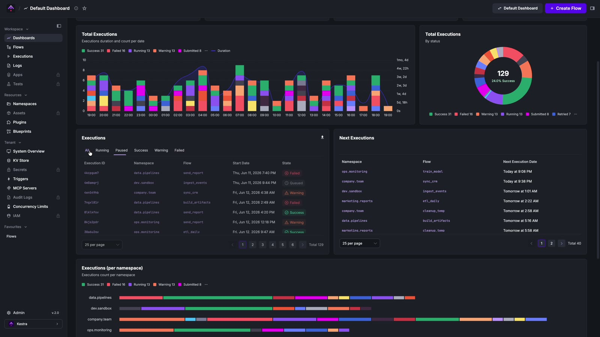
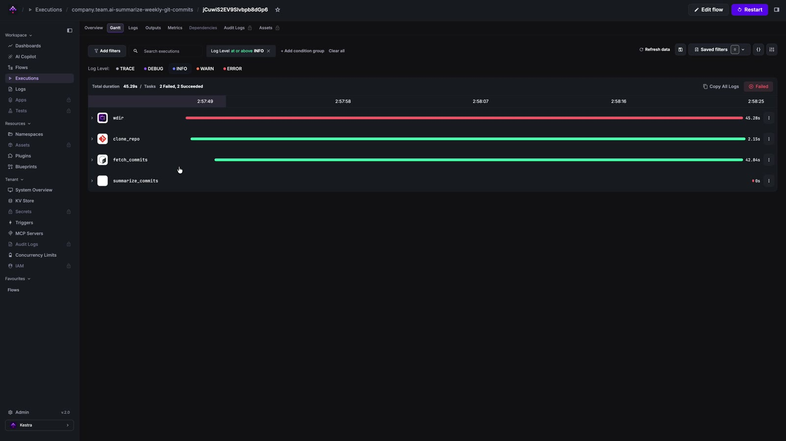
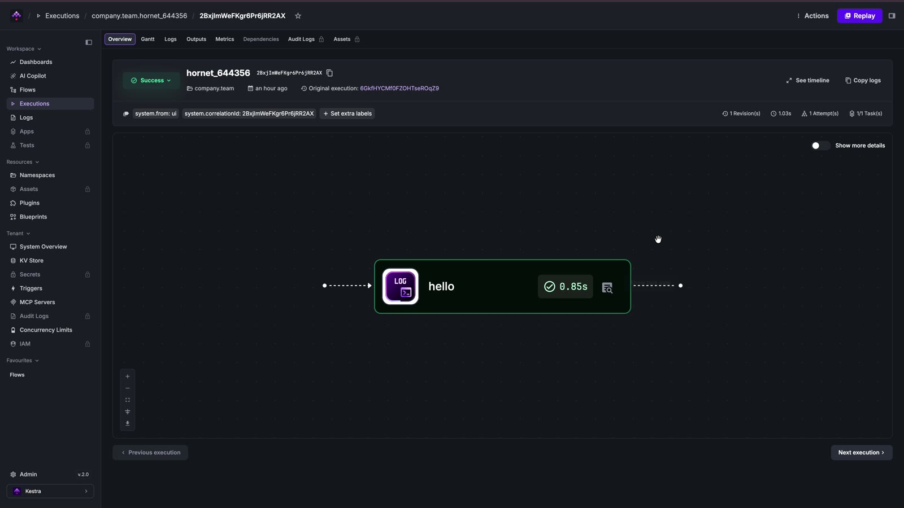
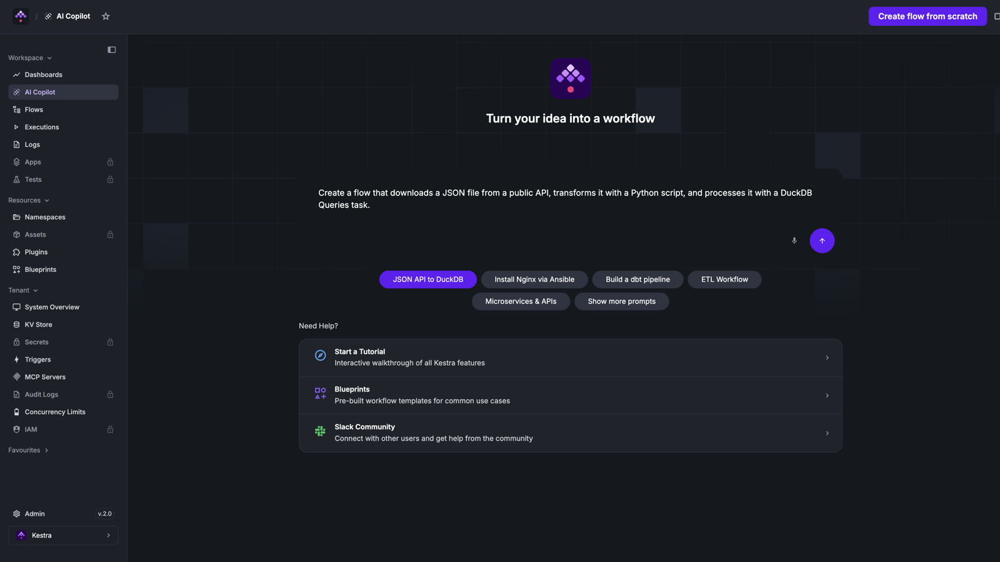

<picture>
  <source media="(prefers-color-scheme: dark)" srcset="./assets/hero-dark.svg" />
  <source media="(prefers-color-scheme: light)" srcset="./assets/hero-light.svg" />
  
</picture>

I work on the frontend of [Kestra](https://github.com/kestra-io/kestra), an open-source orchestration platform. Most of my days go into Vue 3, TypeScript and the design system the whole app is built from: components, tokens, and making dark mode feel designed rather than inverted.

## On GitHub

<picture>
  <source media="(prefers-color-scheme: dark)" srcset="https://github-stats-extended.vercel.app/api?username=Piyush-r-bhaskar&show_icons=true&include_all_commits=true&bg_color=00000000&title_color=b27aff&text_color=e6edf3&icon_color=b27aff&border_color=3d444d&border_radius=8" />
  <source media="(prefers-color-scheme: light)" srcset="https://github-stats-extended.vercel.app/api?username=Piyush-r-bhaskar&show_icons=true&include_all_commits=true&bg_color=00000000&title_color=8405ff&text_color=1f2328&icon_color=8405ff&border_color=d1d9e0&border_radius=8" />
  
</picture>
<picture>
  <source media="(prefers-color-scheme: dark)" srcset="https://streak-stats.demolab.com?user=Piyush-r-bhaskar&background=00000000&border=3d444d&stroke=3d444d&ring=b27aff&fire=b27aff&currStreakNum=e6edf3&sideNums=e6edf3&currStreakLabel=b27aff&sideLabels=e6edf3&dates=9198a1&border_radius=8" />
  <source media="(prefers-color-scheme: light)" srcset="https://streak-stats.demolab.com?user=Piyush-r-bhaskar&background=00000000&border=d1d9e0&stroke=d1d9e0&ring=8405ff&fire=8405ff&currStreakNum=1f2328&sideNums=1f2328&currStreakLabel=8405ff&sideLabels=1f2328&dates=59636e&border_radius=8" />
  
</picture>

## Selected work

<table>
<tr>
<td width="50%" valign="top">

  
<b>Dashboards and charts</b> 
The 2.0 dashboards: stacked charts, status donuts and tables that share one tooltip and one color system.
</td>
<td width="50%" valign="top">

  
<b>Execution Gantt</b> 
A rebuilt timeline of every task in a run, with live durations, log levels and filters.
</td>
</tr>
<tr>
<td width="50%" valign="top">

  
<b>Execution overview</b> 
The page people open after every run: status, labels, timeline and the topology of what ran.
</td>
<td width="50%" valign="top">

  
<b>AI Copilot</b> 
A new home for turning a prompt into a flow, with starter prompts and the draft reviewed on the graph.
</td>
</tr>
</table>

Also: the [Kestra code themes](https://github.com/kestra-io/kestra/pull/22305) used across the app, docs and console, the [folder-style namespace breadcrumb](https://github.com/kestra-io/kestra/pull/19906), the [Policies UI](https://github.com/kestra-io/kestra/pull/17243), the [system overview](https://github.com/kestra-io/kestra/pull/16912), and most of the marketing pages on [kestra.io](https://kestra.io).

## Lately

<!-- SHIPPED:START -->
| Area | Shipped | Merged |
|:--|:--|--:|
| `flows` | [Switch between flows from the breadcrumb](https://github.com/kestra-io/kestra/pull/23192) | Nov 26 |
| `design-system` | [Pebble variables in their own color](https://github.com/kestra-io/kestra/pull/22932) | Nov 19 |
| `flows` | [Review AI Copilot flow drafts on the graph](https://github.com/kestra-io/kestra/pull/22893) | Nov 19 |
| `dashboards` | [Set the color, label and order of chart values](https://github.com/kestra-io/kestra/pull/22555) | Nov 13 |
| `namespaces` | [Create a child namespace from the breadcrumb](https://github.com/kestra-io/kestra/pull/22540) | Nov 12 |
| `topology` | [Render the graph outside the Kestra UI](https://github.com/kestra-io/kestra/pull/22534) | Nov 11 |
<!-- SHIPPED:END -->

## Tools

<picture>
  <source media="(prefers-color-scheme: dark)" srcset="./assets/tools-dark.svg" />
  <source media="(prefers-color-scheme: light)" srcset="./assets/tools-light.svg" />
  
</picture>
